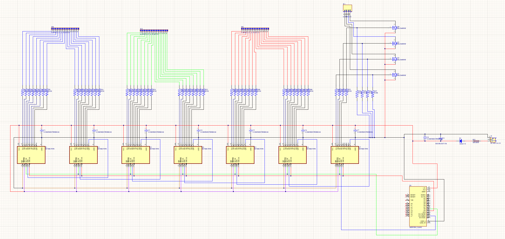
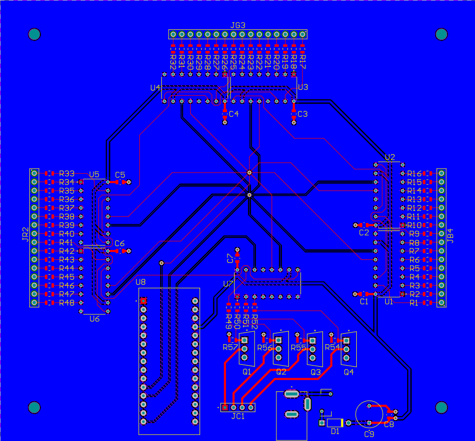
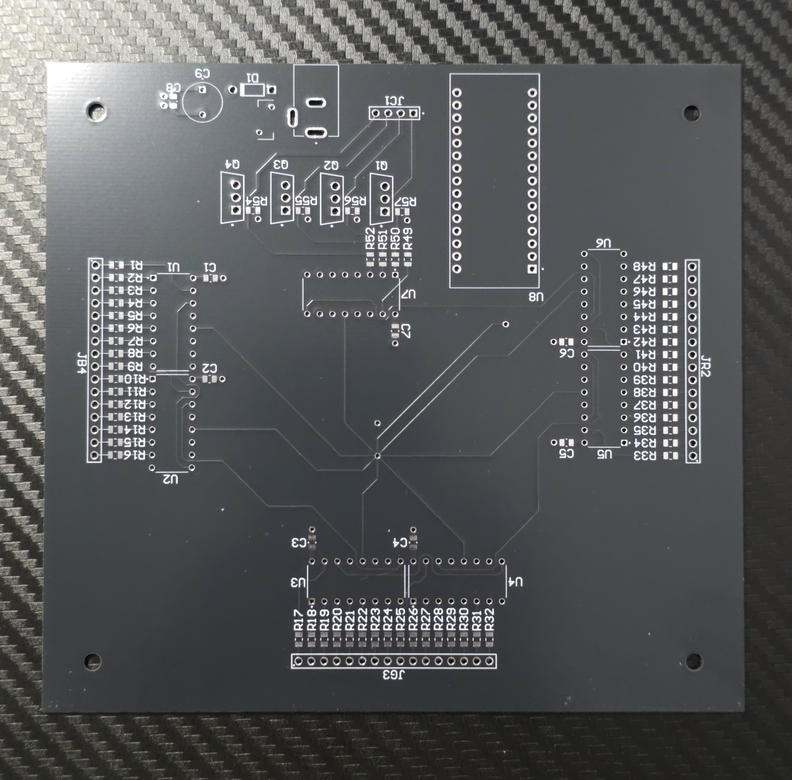
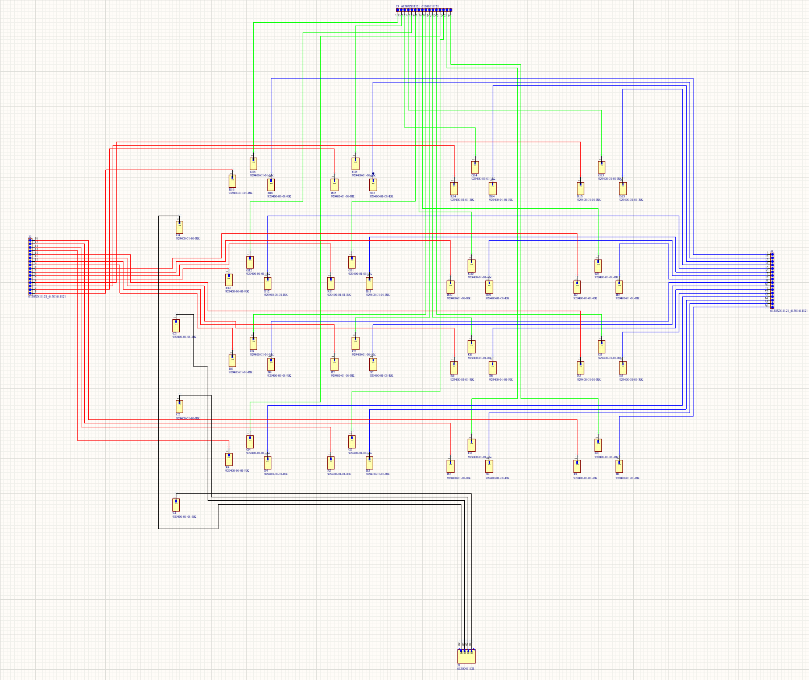
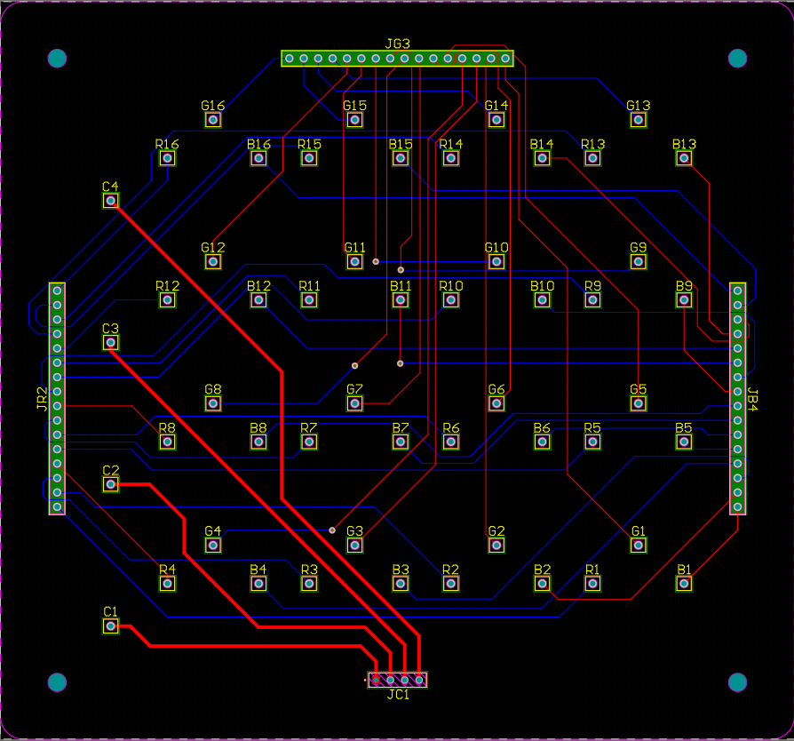
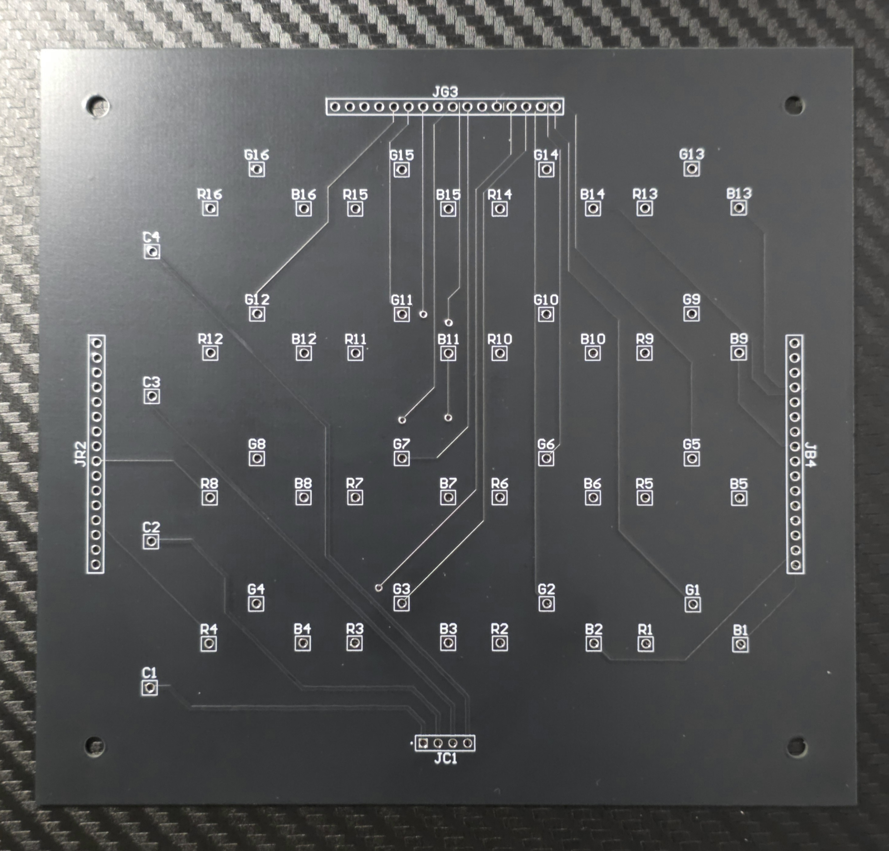
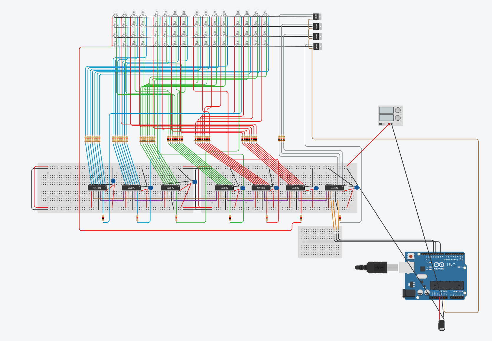
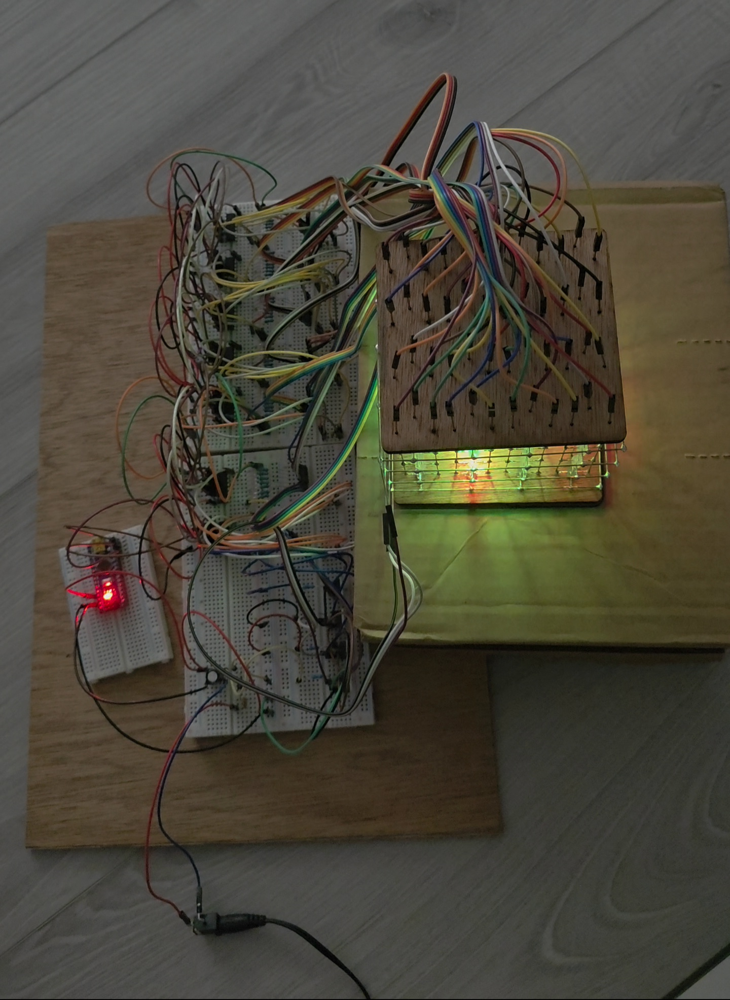
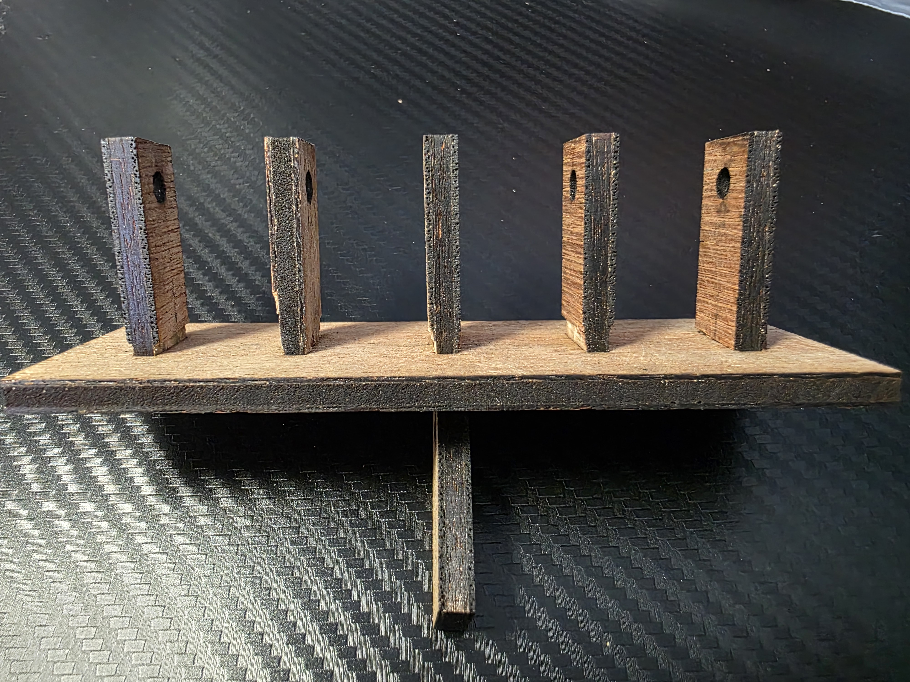

*Click the image above to watch the full 4x4x4 RGB LED Cube demo on YouTube.*

# 4x4x4 RGB LED Cube

This is a custom built 4x4x4 multiplexed RGB LED cube using a two board PCB architecture designed in **Altium Designer**, bare metal register level **C++ firmware** on an ATmega328P, and a custom laser cut soldering fixture modeled in **Autodesk Inventor**.

## System Overview

* **Hardware Architecture:** 64 common cathode 5mm diffused RGB LEDs (192 individual channels) split between a Top Board (LED matrix) and a Bottom Board (driver and control). The matrix is driven by 7 daisy chained `74HC595` shift registers and 4 `IRLZ44N` logic level N channel MOSFETs for low side layer switching.
* **Firmware and Multiplexing:** Bare metal `PORTB` bit banged SPI on an Arduino Nano running a dual phase bit masked multiplexing engine for flicker free persistence of vision.
* **Mechanical Tooling:** Custom 5 slot press fit soldering jig modeled in Autodesk Inventor (`2.5 cm` matrix pitch, `4.9 mm` press fit holes) and laser cut from birch plywood ([`cad/First Jig.svg`](cad/First%20Jig.svg) | [`cad/Second Jig.svg`](cad/Second%20Jig.svg)).

## Hardware Design and Pre Layout Validation

* **Full Schematics:** [`hardware/Schematics.pdf`](hardware/Schematics.pdf)
* **Manufacturing Files:** [`hardware/TopGerber.zip`](hardware/TopGerber.zip) | [`hardware/BottomGerber.zip`](hardware/BottomGerber.zip) | [`hardware/BOM.xlsx`](hardware/BOM.xlsx)

| Schematic Capture (Altium Designer) | 2 Layer PCB Layout | Assembled Hardware |
| :---: | :---: | :---: |
| **Bottom Board (Driver and Control)**  | **Bottom Board Layout**  | **Assembled Bottom PCB**  |
| **Top Board (LED Matrix)**  | **Top Board Layout**  | **Assembled Top PCB**  |

### Prototyping and Component Decisions

* **Shift Register Daisy Chain Validation:** I validated the `74HC595` cascading timing and layer sinking logic in Tinkercad and on a physical breadboard before moving to schematic capture. On the final PCB, I moved `RCLK` from `D11` to `D8` to simplify trace routing.
* **Power Protection and Decoupling:** The power input stage includes a `0.5 A` resettable PTC fuse (`MF-R050`) and a `1N5817` Schottky diode for reverse polarity protection. Power rails are stabilized with a `470 uF` bulk electrolytic capacitor (`C9`) alongside eight `0.1 uF` ceramic decoupling capacitors (`C1` through `C8`) placed near the logic ICs.
* **Low Side Layer Switching:** I chose `IRLZ44N` logic level N channel MOSFETs (Vgs(th) around 1 to 2 V) paired with `10 kΩ` gate pull down resistors (`R54` through `R57`). This ensures the 5V MCU pins fully saturate the gates when sinking up to 48 active LED dies on a single layer while keeping the layers cleanly off during startup.
* **Current Limiting:** Each anode line uses a `330 Ω` 0805 thick film resistor (`R1` through `R52`) to cap per channel LED current safely.

View Prototyping, Breadboard Testing, and Laser Cut Soldering Jig

 

| Tinkercad Simulation | Breadboard Prototype | Laser Cut Soldering Jig |
| :---: | :---: | :---: |
|  |  |  |

## Engineering Challenges and Firmware Solutions

### 1. Protecting `74HC595` Package Current Limits
Standard `74HC595` shift registers have an absolute maximum Icc limit of `70 mA` per IC. Lighting up a full white (`R+G+B`) 4x4 plane drives all 8 outputs high at the same time, which pushes past safe package current limits. To solve this in software, I wrote a dual phase scan in `renderFrameFast()` ([`Full_Effect.ino`](firmware/Full_Effect.ino)) using alternating `0x0F` and `0xF0` bit masks. This caps active outputs at **4 pins or fewer per shift register** at any given microsecond while scanning fast enough across all 4 Z layers to look completely solid.

### 2. Compensating for Asymmetric PCB Trace Routing
Optimizing trace routing on a 2 layer board mirrored the physical `(x, y)` column order of the Red and Green banks relative to the Blue bank. I wrote a single LED `(x, y, z)` sweep diagnostic ([`LED_TEST.ino`](firmware/LED_TEST.ino)) to verify the physical bit mapping across all 192 channels, then fixed the coordinate offset in O(1) time using separate 16 byte lookup tables (`greenRedMap` and `blueMap`) inside `setLED()`.

### 3. Bare Metal `PORTB` Register Manipulation
I replaced standard Arduino `digitalWrite()` calls with direct `PORTB` bit banging on `D8` (`RCLK`), `D9` (`SRCLK`), and `D12` (`SER`). Cutting out the function call overhead boosted the refresh rate and eliminated visible scanline flicker.

## Lessons Learned and Rev 2.0 Improvements

1. **Constant Current LED Drivers:** Swapping the `74HC595` shift registers and discrete anode resistors for constant current sink drivers like the `STP16CPC26` or `TLC5940` would remove the `70 mA` package bottleneck, eliminate the need for dual phase duty cycle splitting, and increase peak brightness.
2. **Hardware SPI Routing:** Mapping `SER` to `MOSI` (`D11`) and `SRCLK` to `SCK` (`D13`) in a future revision would offload shift register transfers to the ATmega328P hardware SPI peripheral at `8 MHz`.
3. **Series Gate Damping Resistors:** Adding `100 Ω` series resistors on the `IRLZ44N` MOSFET gates would further limit peak gate charging current and reduce high frequency ringing during fast layer transitions.
